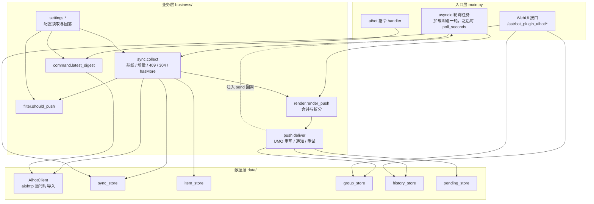

# AIHOT 精选监控 · 技术设计

Feature Name: aihot-monitor
Spec Directory: 2026-10-26-aihot-monitor
Updated: 2026-10-26

## Description

插件按固定间隔读 AIHOT 的 `/api/v1/selected/*` 增量接口，把新入选的精选条目合并成一条消息，推送到 WebUI 里开启的群。修改与撤选只在本地更新；推送失败进待重试队列，最多补 3 轮。

关键取舍：

- **只用 `selected/snapshot` + `selected/changes`**：这是官方唯一带「新增 / 修改 / 撤选」语义的路径，`items?mode=selected&by=timeline` 只能靠回溯猜窗口。代价是要多存一个游标。
- **首轮用 `snapshot?limit=1` 建基线**：实测 `cursor` 是「整档同步游标」，与返回条数无关（本次响应显示全站 7718 条精选、`count=3`），所以不必枚举全量。代价是不能靠首轮建立完整的已推记录集，只能保证「游标之后的条目」不重不漏。
- **业务层不 import astrbot**：`business/push.py` 通过注入的 `send` 回调发消息，`business/command.py` 只返回字符串。单测因此不需要装 AstrBot。
- **UMO 前缀按平台实例 `meta().id` 重写**：平台配置 id 可能是 `napcat` 之类，`send_message` 按 `meta().id` 匹配，前缀写错会报 `cannot find platform`。

## Architecture



数据流：`snapshot/changes → changes[] → 去重（item_store）→ 过滤（filter）→ 合并渲染（render）→ 逐群推送（push）→ 历史与游标写库`。

## Components and Interfaces

### 实体层 `entity/`

`entity/constants.py`

```python
PLUGIN_NAME = "astrbot_plugin_aihot"
API_ORIGIN = "https://aihot.news"
SNAPSHOT_PATH = "/api/v1/selected/snapshot"
CHANGES_PATH = "/api/v1/selected/changes"
ITEMS_PATH = "/api/v1/items"
GROUP_MESSAGE_TYPE = "GroupMessage"
SUMMARY_LIMIT = 120          # 单条摘要截断字数
MESSAGE_CHAR_LIMIT = 1500    # 单条消息正文字数上限
MAX_ITEMS_DEFAULT = 10       # 每轮最多推送条数
HISTORY_LIMIT = 200          # 推送记录保留条数
MAX_RETRY = 3                # 待重试队列最多补推轮数
MAX_CHANGES_CALLS = 10       # 单轮增量请求次数上限
MIN_POLL_SECONDS = 60
POLL_SECONDS_DEFAULT = 900
COMMAND_LIMIT_DEFAULT = 5
COMMAND_LIMIT_MAX = 10
CATEGORY_LABELS = {
    "ai-models": "模型发布",
    "ai-products": "产品更新",
    "industry": "行业动态",
    "paper": "论文研究",
    "tip": "教程实践",
    "opinion": "大佬观点",
}
```

`entity/record.py`（dataclass，纯数据，不依赖 AstrBot 与数据库）

| 类型 | 字段 |
|---|---|
| `ItemRecord` | `item_id`、`title`、`summary`、`category`、`score`、`source_name`、`link_aihot`、`link_original` |
| `ChangeEntry` | `op`（`upsert`/`remove`）、`changed_at`、`item: ItemRecord | None`、`item_id` |
| `GroupRow` | `group_id`、`remark`、`enabled`、`umo`、`notice_sent`、`last_push_at`、`last_error`、`fail_count` |
| `SyncState` | `cursor`、`etag`、`last_poll_at`、`last_error`、`last_result` |
| `PendingRow` | `group_id`、`item_id`、`text`、`attempts`、`created_at` |
| `FetchResult` | `status`（HTTP 状态，0 表示网络层失败）、`data`、`error`、`retry_after` |
| `CollectResult` | `candidates`、`total_changed`、`cursor`、`etag`、`calls`、`failed`、`skip_reason` |
| `DeliverResult` | `sent`、`failed`、`details` |
| `ActionResult` | `error`、`row` |

### 数据层 `data/`

`data/db.py`：`connect(path) -> sqlite3.Connection`、`create_table(conn, sql)`、`init_schema(conn)`。用标准库 `sqlite3`，异步包装走 `asyncio.to_thread` + `asyncio.Lock`，热路径读内存快照（写先落库再改内存），与 `astrbot_plugin_codex_reset` 的存储形态一致，`requirements.txt` 因此只有 `aiohttp`。

`data/client.py`

```python
class AihotClient:
    def __init__(self, user_agent: str, timeout_seconds: int, proxy: str = "") -> None: ...
    async def snapshot(self, limit: int = 1) -> FetchResult: ...
    async def changes(self, cursor: str, etag: str = "") -> FetchResult: ...
    async def latest(self, limit: int) -> FetchResult: ...
```

- `aiohttp` 在函数内运行时导入（`_aiohttp()`），单测不打网络时不装也能跑。
- 统一带 `Accept-Encoding: gzip`、`User-Agent`；`changes` 带 `If-None-Match`。
- 返回 `FetchResult`，不抛业务异常；`status=0` 表示超时/连接失败，`retry_after` 取 `Retry-After` 头。

存储类（每个类只管自己的表，构造函数接 `连接`）：

| 类 | 方法 |
|---|---|
| `SyncStore` | `load() -> SyncState`、`save_cursor(cursor, etag)`、`clear()`、`note_poll(result, error)` |
| `ItemStore` | `exists(item_id) -> bool`、`save_pushed(item)`、`mark_updated(item)`、`mark_removed(item_id)`、`count() -> int` |
| `GroupStore` | `list_all() -> list[GroupRow]`、`get(group_id)`、`insert(row)`、`save(row)`、`delete(group_id)`、`enabled_rows()`、`save_umo(group_id, umo)`、`note_push_ok(group_id, at)`、`note_push_fail(group_id, error)`、`mark_notice_sent(group_id)` |
| `HistoryStore` | `append(group_id, item_id, title, ok, error)`、`trim()`、`recent(limit=200)` |
| `PendingStore` | `enqueue(row)`、`for_group(group_id)`、`bump_attempts(group_id, item_id)`、`delete(group_id, item_id)`、`count()` |

`group`、`sync_state`、`pending_push` 在 `__init__` 时读进内存，读路径直接返回快照；写路径 `to_thread` 落库成功后才更新内存。

### 业务层 `business/`

`business/settings.py`：全部 `(config, key) -> 值` 形式的纯函数，缺失或类型不符时返回默认值。

```python
def poll_seconds(config) -> int          # 小于 60 按 60
def command_limit(config) -> int         # 夹在 1..10
def categories(config) -> list[str]
def min_score(config) -> float
def keywords_block(config) -> list[str]
def keywords_allow(config) -> list[str]
def max_items(config) -> int
def notice_enabled(config) -> bool
def proxy(config) -> str
def timeout_seconds(config) -> int
def user_agent(config) -> str
```

`business/filter.py`

```python
@dataclass(frozen=True)
class FilterRules:
    categories: list[str]
    min_score: float
    block: list[str]
    allow: list[str]

def build_rules(config) -> FilterRules: ...
def should_push(item: ItemRecord, rules: FilterRules) -> bool: ...
```

判定顺序：`score < min_score` → 丢；命中黑名单 → 丢；白名单非空且未命中 → 丢；分类列表非空且分类不在其中 → 丢。分类为空表示全放行。

`business/render.py`

```python
def category_label(category: str | None) -> str        # 未映射与 None 返回「其他」
def trim_summary(summary: str | None) -> str            # 截到 SUMMARY_LIMIT，补省略号
def render_item(index: int, item: ItemRecord) -> str    # 序号+标题 / 摘要 / 分类·来源 / 双链接
def render_push(items: list[ItemRecord], total: int) -> list[str]   # 返回待发消息列表
def render_digest(items: list[ItemRecord]) -> str       # aihot 指令用，复用 render_item
def render_notice() -> str                              # 开启通知，含 aihot 用法提示
def split_messages(blocks: list[str]) -> list[str]      # 按 1500 字边界拆分并加「第 x/y 段」
```

`render_push` 规则：候选 0 条返回空列表；超过 `max_items` 只取前 N 条并追加「另有 M 条未推送」；拼装后交 `split_messages` 拆分。

`business/sync.py`

```python
async def collect(client, sync_store, item_store, rules, max_items, now) -> CollectResult
```

流程：读 `SyncState`；`cursor` 为空 → `snapshot(limit=1)` 写游标后返回空候选；否则循环 `changes(cursor, etag)`：`304` → 空候选并保留游标；`409 snapshot_required` → `clear()` 后返回空候选；`200` → 逐条 `changes[]` 处理（`upsert` 未见过入候选并 `save_pushed`；`upsert` 已见过 `mark_updated`；`remove` → `mark_removed`），`hasMore` 为真且未超 `MAX_CHANGES_CALLS` 继续，否则保留原游标退出。

`business/push.py`

```python
def umo_for(group_id: str, platform_id: str) -> str
def rewrite_umo(umo: str, platform_id: str) -> str      # 前缀不一致时换成当前实例 id
async def deliver(groups, pending, history, texts, sender, platform_id, now) -> DeliverResult
```

`deliver` 不 import astrbot，`sender` 是 `async (umo: str, text: str) -> tuple[bool, str]` 回调，由 `main.py` 用 `context.send_message` + `MessageChain` 实现。

单群顺序：开关关 → 跳过；UMO 解析失败 → 记错误跳过；`notice_sent=0` 且启用通知 → 先发通知；待重试队列该群内容先补推（成功即删除，失败 `bump_attempts`，达 3 次删除并记日志）；最后发本轮 `texts`（失败则 `enqueue`）。

`business/command.py`

```python
async def latest_digest(client, limit) -> tuple[str | None, str]
```

返回 `(正文, 错误)`；正文为空时由入口回固定失败提示。

### 入口层 `main.py`

```python
class AihotPlugin(Star):
    def __init__(self, context: Context, config=None): ...   # 建库、建 store、起轮询任务、注册 WebUI、注册指令
    async def terminate(self): ...                            # 取消轮询任务
    async def _tick(self) -> int: ...                         # 跑一轮，返回下轮等待秒数
    async def _sender(self, umo: str, text: str) -> tuple[bool, str]: ...  # MessageChain 封装
    def _platform_id(self) -> str: ...                        # 配置值，否则取 aiocqhttp 实例 meta().id
    async def aihot(self, event: AstrMessageEvent): ...        # @filter.command("aihot")
```

WebUI 路由（`context.register_web_api`，全部带 `/{PLUGIN_NAME}` 前缀）：

| 方法 | 路由 | 作用 |
|---|---|---|
| GET | `/astrbot_plugin_aihot/groups` | 群列表 |
| POST | `/astrbot_plugin_aihot/groups` | 新增群 |
| POST | `/astrbot_plugin_aihot/groups/update` | 改备注/开关 |
| POST | `/astrbot_plugin_aihot/groups/delete` | 删群 |
| GET | `/astrbot_plugin_aihot/status` | 游标摘要、上次轮询、待重试条数 |
| POST | `/astrbot_plugin_aihot/test-push` | 向指定群发样例 |
| GET | `/astrbot_plugin_aihot/history` | 最近 200 条记录 |
| GET/PUT | `/astrbot_plugin_aihot/settings` | 非密钥配置读写 |

`_tick` 顺序：`collect` → 无候选且无待重试 → 只更新 `sync_state.last_poll_at` 并返回；否则 `render_push` → `deliver` → 写游标/ETag/`last_result`。

### 前端 `dashboard/` → `views/monitor/`

复用 `astrbot_plugin_codex_reset` 的 `dashboard/` 骨架（`vite.config.ts`、`bridge.ts`、`App.tsx`、antd `@layer` 方案），React 19 + antd 6 + TypeScript，Vite 打成单份 IIFE 输出 `views/monitor/assets/index.js` 与 `style.css`，HTML 用 `<script defer>`。页内 antd `Tabs` 切「监控群 / 监控状态 / 推送记录 / 全局配置」，测试推送按钮放监控群行内。

### 配置 `_conf_schema.json`

字段与默认值见 Requirement 10；`platform_id` 只存实例 ID（不含冒号），不是密钥，标 `secret` 的字段本插件没有。

## Data Models

```sql
-- 推送目标
CREATE TABLE IF NOT EXISTS monitor_group (
    group_id     TEXT PRIMARY KEY,
    remark       TEXT    NOT NULL DEFAULT '',
    enabled      INTEGER NOT NULL DEFAULT 1,
    umo          TEXT    NOT NULL DEFAULT '',
    notice_sent  INTEGER NOT NULL DEFAULT 0,
    last_push_at TEXT    NOT NULL DEFAULT '',
    last_error   TEXT    NOT NULL DEFAULT '',
    fail_count   INTEGER NOT NULL DEFAULT 0
);

-- 已推记录（去重依据，永久保留）
CREATE TABLE IF NOT EXISTS pushed_item (
    item_id         TEXT PRIMARY KEY,
    title           TEXT NOT NULL,
    category        TEXT,
    score           REAL,
    first_pushed_at TEXT NOT NULL,
    updated_at      TEXT NOT NULL DEFAULT '',
    removed         INTEGER NOT NULL DEFAULT 0
);

-- 推送流水，只留最近 200 条
CREATE TABLE IF NOT EXISTS push_history (
    id        INTEGER PRIMARY KEY AUTOINCREMENT,
    group_id  TEXT NOT NULL,
    item_id   TEXT,
    title     TEXT NOT NULL DEFAULT '',
    pushed_at TEXT NOT NULL,
    ok        INTEGER NOT NULL,
    error     TEXT NOT NULL DEFAULT ''
);
CREATE INDEX IF NOT EXISTS idx_push_history_time ON push_history(pushed_at DESC);

-- 单行同步状态
CREATE TABLE IF NOT EXISTS sync_state (
    id           INTEGER PRIMARY KEY CHECK (id = 1),
    cursor       TEXT NOT NULL DEFAULT '',
    etag         TEXT NOT NULL DEFAULT '',
    last_poll_at TEXT NOT NULL DEFAULT '',
    last_result  TEXT NOT NULL DEFAULT '',
    last_error   TEXT NOT NULL DEFAULT ''
);

-- 待重试队列
CREATE TABLE IF NOT EXISTS pending_push (
    group_id   TEXT NOT NULL,
    item_id    TEXT NOT NULL,
    text       TEXT NOT NULL,
    attempts   INTEGER NOT NULL DEFAULT 0,
    created_at TEXT NOT NULL,
    PRIMARY KEY (group_id, item_id)
);
```

时间字段统一存 UTC ISO 8601（`datetime.now(timezone.utc).isoformat()`），页面显示时再转本地。`pushed_item.removed` 与 `updated_at` 只用于本地对账与页面展示，不参与推送。

## Correctness Properties

1. **不重推**：同一条目在 `pushed_item` 落地后，任何后续轮次都不再进入候选；`hasMore` 截断导致的重复拉取由该性质兜住。
2. **游标单调**：`sync_state.cursor` 只在整轮群处理结束后写入，且只写「本轮最后一个 `hasMore=false` 响应的 cursor」；异常轮次保留原值。
3. **空跑静默**：候选为空且待重试队列为空时，本轮不产生任何消息、历史与 `pushed_item` 写入，只更新 `last_poll_at`。
4. **开关优先**：`enabled=0` 的群既不收通知也不收内容，任何失败都不会自动改开关。
5. **长度约束**：拆分后每条消息正文不超过 1500 字，且不切断单个条目。
6. **重试有界**：`pending_push.attempts` 达到 3 后该行被删除，队列不会无限增长。
7. **过滤优先序**：分数 → 黑名单 → 白名单 → 分类；分类空列表等价于全放行；同一目同时命中黑白名单时丢弃。
8. **UMO 一致**：写库与发送用的 UMO 前缀等于平台实例 `meta().id`，重写后立即落库。

## Error Handling

| 场景 | 处理 |
|---|---|
| 快照 / 增量请求超时或连接失败（`status=0`） | 记 `sync_state.last_error`，本轮跳过，下轮按 `poll_seconds` 重试；游标不动 |
| 429 | 读 `Retry-After`，下轮等待 `max(Retry-After, poll_seconds)` |
| 409 `snapshot_required` | 清游标与 ETag，下一轮重建基线 |
| 304 | 视为「无变化」，只更新 `last_poll_at` |
| 响应 JSON 结构不符（缺 `changes` 或 `cursor`） | 视为本轮失败，记 `last_error`，不推进游标 |
| `platform_id` 为空且群 UMO 为空 | 该群记 `last_error="缺少会话"`，不发送 |
| `send_message` 抛异常或返回未发出 | 内容进 `pending_push`，`fail_count+1`，页面标红 |
| 数据库写入失败 | 该轮操作整体回滚（先落库再改内存），只在日志记一条，下一轮重做 |
| `snapshot?limit=1` 返回 `items` 为空 | 仍按响应 `cursor` 建基线，视为正常 |

## Test Strategy

`python3 -m unittest discover -s tests -t .`，不装 AstrBot、不打网络。

- **夹具**：`tests/fixtures/` 存真实响应脱敏副本（`snapshot_min.json`、`changes_upsert.json`、`changes_remove.json`、`changes_304.json`、`changes_409.json`、`items_latest.json`），来自本次核对的实际响应结构。
- **假客户端**：`FakeClient` 返回预设 `FetchResult` 序列，验证 `collect` 的 304 / 409 / `hasMore` / 截断四条分支。
- **临时库**：`tempfile.TemporaryDirectory()` 下建 SQLite，每个用例独立。
- **假 sender**：`push.deliver` 注入 `async def sender(umo, text) -> (ok, error)`，断言 UMO 重写、通知只发一次、失败入队、`attempts=3` 后删除、成功清零 `fail_count`。
- **渲染**：断言摘要截断 120 字、分类中文映射、`summary` 为空时省行、1500 字拆分带「第 x/y 段」、超过 10 条注明剩余。
- **过滤**：分类空列表放行、黑名单优先、白名单非空收敛、`score` 阈值。
- **配置回落**：缺失键取默认、`poll_seconds<60` 按 60、`command_limit>10` 按 10。
- **不覆盖**：真实群推送、WebUI 页面交互、平台适配器行为，由部署后的实例验证。

## References

[^1]: (Website) - [AIHOT llms.txt，接口清单与请求纪律](https://aihot.news/llms.txt)
[^2]: (Website) - [AIHOT OpenAPI 2.0.0 规范，`SelectedChanges` / `SelectedUpsert` / `SelectedRemove` / `Item` 定义](https://aihot.news/openapi-v1.json)
[^3]: (Website) - [AIHOT 公开使用规则](https://aihot.news/terms)
[^4]: (AstrBot#docs) - [消息的发送：主动消息与 UMO](https://github.com/AstrBotDevs/AstrBot/blob/master/docs/zh/dev/star/guides/send-message.md)
[^5]: (AstrBot#docs) - [插件配置与 `save_config()`](https://github.com/AstrBotDevs/AstrBot/blob/master/docs/zh/dev/star/guides/plugin-config.md)
[^6]: (AstrBot#docs) - [插件 Pages](https://github.com/AstrBotDevs/AstrBot/blob/master/docs/zh/dev/star/guides/plugin-pages.md)
[^7]: (AstrBot#docs) - [插件存储与数据目录](https://github.com/AstrBotDevs/AstrBot/blob/master/docs/zh/dev/star/guides/storage.md)
[^8]: (repo) - [astrbot_plugin_codex_reset：同形态的轮询推送插件，分层与页面骨架参照](https://github.com/w1ndys/astrbot_plugin_codex_reset)
